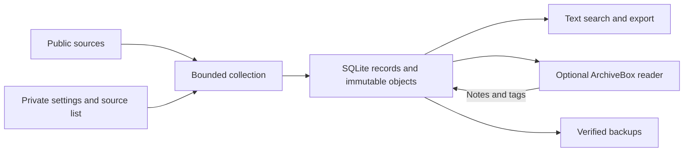

# Public Content Library

Keep a local, searchable library of public articles, research, professional posts and transcripts. Retain source links and older editions, add your own notes and tags, and refresh the collection on a schedule you choose.

**Status: early Mac-first release.** Collection is bounded and source-dependent. A successful run does not establish complete coverage of a person, platform or history. The public repository contains software and synthetic examples; each installation keeps its settings and saved material separately.

## Try it without collecting anything

Python 3.12 or later is required. From a checkout:

```sh
python3 -m venv .venv
.venv/bin/python -m pip install '.[media]'
.venv/bin/pcl demo --output /tmp/pcl-demo
```

Use a new output directory. The offline demo saves two synthetic editions, finds a term in the second edition, retains a private annotation, exports the library, and verifies a backup. It makes no source requests and installs no scheduled job.

## What it does

- Collects bounded HTML/text, RSS/Atom, PDFs, publisher transcripts, available YouTube captions and supported public X responses.
- Keeps immutable captured objects and versions alongside source evidence, acquisition status, review decisions, notes and tags.
- Searches saved text with SQLite; optionally publishes readable editions to a local ArchiveBox interface.
- Resumes bounded audio downloads, validates complete files, and keeps previous editions. Audio is opt-in.
- Runs a weekly workflow on macOS, with limits, resumable work and verified backups. External storage is checked before configured jobs use it.

No paid API or AI model is required by the core. Platform access can fail or change. X support uses anonymous third-party response formats and does **not** guarantee full timelines, full threads or historical search. Local speech recognition is an optional excerpt adapter; automatic whole-library transcription and original video downloading are not implemented.

## Create your own installation

Choose a private configuration directory and a separate data directory. Keep the program and configuration on the computer. This example chooses Wednesday 08:15 UTC; replace the schedule with your preference.

```sh
.venv/bin/pcl init \
  --config-home "$HOME/Library/Application Support/Public Content Library" \
  --data-root "$HOME/Public Content Library Data" \
  --weekday wed --time 08:15 --timezone UTC
```

For an external disk, replace `--data-root` with a new folder on the mounted disk and add `--external-mount /Volumes/YOUR_DISK`. Initialization refuses existing directories. On macOS it records the volume UUID and a library identity marker. It never formats a disk.

Copy suitable entries from [examples/sources.example.json](examples/sources.example.json) into your private `sources.json`, enable them and replace the example URLs. Then:

```sh
.venv/bin/pcl update --config "$HOME/Library/Application Support/Public Content Library/settings.json"
.venv/bin/pcl status --config "$HOME/Library/Application Support/Public Content Library/settings.json"
.venv/bin/pcl search --config "$HOME/Library/Application Support/Public Content Library/settings.json" "your search"
```

An update can return exit code `2` for partial source coverage while still saving a verified backup. Inspect the report in `operations/latest-update.txt`. On a Mac whose system timezone matches your chosen timezone, install the weekly job **after a verified manual update**:

```sh
.venv/bin/pcl schedule install --config "$HOME/Library/Application Support/Public Content Library/settings.json"
```

Use `schedule status` or `schedule remove` to inspect or pause it. If the external disk is absent, the configured job records that on the computer and leaves the week uncompleted. Mounting the disk or logging in triggers a due-period check. The Mac must be powered on and the user logged in; this is not an always-on server.

## How the pieces fit



The code checkout is independent of the data location. An external installation keeps state, media, the reading archive and backups on the disk, with small settings and service control files on the computer. See [storage and recovery](docs/storage.md), [configuration](docs/configuration.md), and the [ArchiveBox integration](docs/archivebox.md).

## Develop

```sh
.venv/bin/python -m unittest discover -s tests -v
```

`library/collector` owns records, versions and search. `library/media` owns transcript extraction and bounded downloads. `library/bridge` adapts ArchiveBox. `library/ops` owns workflow and Mac service management. `tests` contains authored synthetic fixtures, including local HTTP servers. The supplied GitHub Actions template covers macOS and Linux; native ArchiveBox validation is a separate integration check. To enable hosted checks, place docs/ci-tests.yml at .github/workflows/tests.yml using a GitHub sign-in with workflow permission.

The project began as a private pilot for public professional content about Claude and Anthropic. It is independent of Anthropic and ArchiveBox. Some retained rendering text reflects that initial scope. Broader source discovery, better coverage reporting and cross-device access remain future work.

## License

[MIT](LICENSE) applies to this repository's code and authored examples. Downloaded source material and dependencies retain their own terms and licenses. Do not commit your library, cookies, login information or private source lists to this repository.
